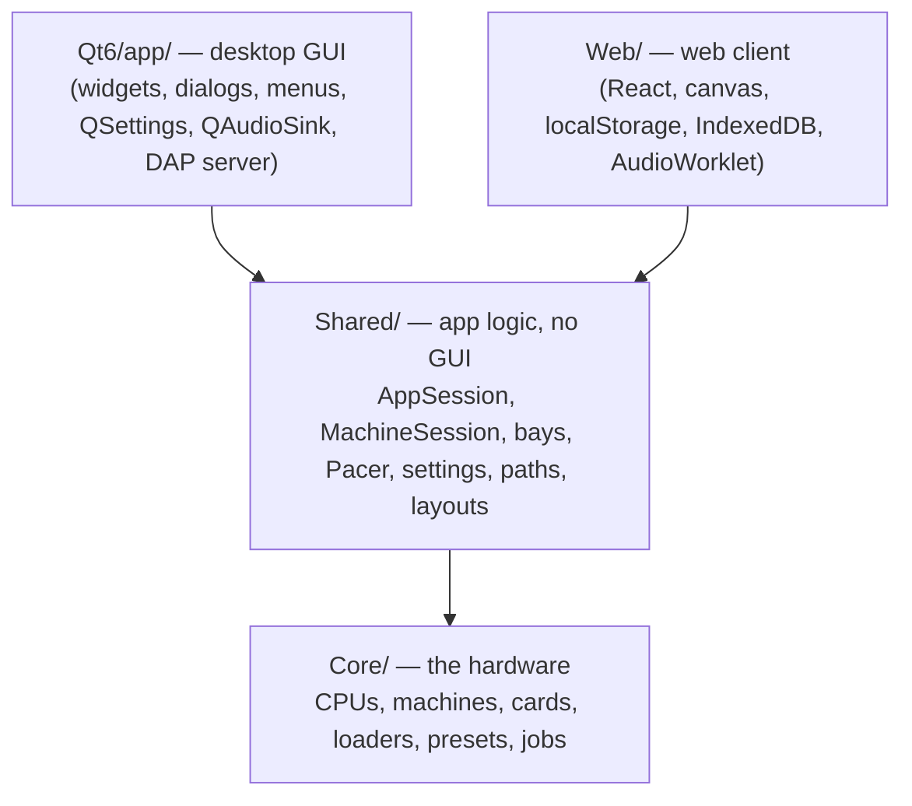

# Shared architecture: Core, Shared, frontends

Calc-U-1600 is built in three layers, so the desktop app and the
WebAssembly client ([Web-Client.md](Web-Client.md)) run the same emulator
and the same app logic:

- **`Core/`** is the emulated hardware and what drives it: CPUs, machines,
  cards and connectors, program and preset loaders, the debugger core.
- **`Shared/`** is everything above Core that is not drawing: the live
  machine and its operations, the module/floppy/tape bays, pacing and audio
  policy, settings keys, file locations, and the layout numbers renderers
  draw with.
- **A frontend** keeps widgets and painting, dialogs, menus, settings
  storage, the audio device, the debugger transport and packaging.

Both libraries are built by [`cmake/CalcU.cmake`](../../cmake/CalcU.cmake)
(`calcu_core`, `calcu_shared`) for the Qt app, the CLIs, the tests and the
WebAssembly check.

## Rules

- **Non-GUI logic goes in `Shared/`.** A frontend translates types only
  (QString ↔ `std::string`, Qt keys → `shared::HostKey`, pixel buffers →
  QImage) and shows what Shared decides.
- **Portable C++20, standard library only.** No Qt, Cocoa or Emscripten
  headers in Core or Shared. Paths are UTF-8 `std::string`s converted
  through `Shared/Utf8Path.hpp` (Windows code pages).
- **Single-threaded and never blocking.** Everything runs on the
  frontend's one thread. Long machine work (a boot, a preset, a typed
  program, a power cycle) is a resumable job (below), never a blocking
  loop with a yield hook. There is no threaded mode (unlike Calc-U-59's
  Shared layer); see Decisions.md.
- **Shared never decides where files live.** The frontend hands it the home
  and bundled-resources folders (`shared::HostDirs`) and a settings store
  (`shared::SettingsStore`); `shared::AppPaths` and `shared::Settings` do the
  rest.
- **Messages for the user** come back as English sentences (the app has no
  translations).

## The pieces

| File | What it is |
|---|---|
| `AppSession` | The whole emulator behind one frontend: owns `MachineSession`, the bays, the `Pacer` and the `AudioPump`, wires them, runs operations, `tick()` |
| `MachineSession` | The live PC-1500/1500A/1600: model and ROM switches, host keys (`hostKeyDown`) and paste queue, display, audio, memory-module slots, peripherals, tape, host drive, trace, inspector, serial links |
| `ModuleBay`, `FloppyBay`, `TapeBay` | The control bar's slots, disk and tape: catalogues, attach, Name & Save, preset `saveas:`, debounced autosave |
| `Pacer`, `AudioPump` | Frame ticks → emulated time (absolute deadline, turbo); buzzer PCM → an `AudioSink` |
| `Settings`, `AppPaths`, `Utf8Path` | Every settings key with its default; the save/tapes/bundle folders and by-name save paths |
| `HostKeyMap`, `KeyLayout/`, `LcdLayout`, `PlotterPaper`, `Rgb` | Host keys → calculator keys; key hit-regions and the faceplate fit; LCD geometry, colours and status indicators (`lcd::indicators()`); plotter-paper geometry |
| `MachineModel` | The `Model` and ROM-version enums |

## How a frontend drives it

1. Implement `shared::AppSession::Platform`. It is a
   `MachineSession::Listener` (a missing ROM, notices, model switched,
   machine replaced, debugger hooks) plus the app's own events: bay
   errors, preset log and "armed", a failed attach, `busyChanged` (resync
   the whole UI when an operation ends). The bays' part in a rebuild
   (`MachineSession::Bays`) is AppSession's own business.
2. Build `Settings` (over its store), `AppPaths` (with its `HostDirs`) and
   the `AppSession`; `attachAudio()` the host's `AudioSink`; call `start()`
   to boot the startup model.
3. Call `tick()` from a ~60 Hz timer. It runs a slice of the running
   operation, or paced emulation (`pacer().setTurbo()` for fast-forward),
   then the per-frame duties (autosave, tape), then plays the buzzer (or
   throws turbo and operation audio away). Repaint from
   `machine().currentDisplay()` and `lcd::indicators()`, plotter points,
   printer output, `tapeStatus()`. A frozen frontend (screenshots) uses
   `runFor()` / `runUntilPasteDone()` instead.
4. Resolve host keys with `resolveHostKey()` and hand them to
   `machine().hostKeyDown()`; release what it asks to with `hostKeyUp()`,
   and send a bare Shift tap to `hostShiftTap()`.
5. Start operations — `loadPresetJob()`, `resetJob()`, `selectModelJob()`,
   `togglePeripheralJob()`, … — with `start(op, done)`; a browser waits for
   `done`. A desktop app may instead `runNow(op, pump)`, which steps the job
   in 10 ms slices and calls `pump` between them (the Qt app keeps painting
   and shows its "Loading…" popup there).

The Qt app does exactly this: `MachineController` owns the `AppSession`
and is its Platform, `EmulationPacer` calls `tick()` from a QTimer,
`SyncOperations` runs operations with `runNow()`, `AudioOutput` is the
QAudioSink, and `MainWindow` keeps only the physical-key map and the
Shift-tap timer.

## Jobs: resumable machine work

[`Core/Job.hpp`](../../Core/Job.hpp) turns the blocking sequences into
C++20 coroutines. Wherever the code ran the machine — `machine.runCycles(n)`
— it now says `co_await job::run(machine, n)`. A `job::Job` runs the
coroutine a budget at a time (`step(cycles)`), or straight through
(`job::runToCompletion()`, which every old blocking function name now
calls, so the CLIs and tests didn't change).

A run request is never split by the budget, so a job sliced into frame
ticks makes exactly the machine calls of one run straight through:
`Core/tests/job_tests.cpp` checks five presets for identical step logs,
results, memory, PCs and LCD both ways.

Writing one: every function that (transitively) runs the machine returns
`job::Task<T>` and awaits the ones it calls; take parameters by value
(except the machine and out-pointers) — a Task starts lazily, after the
expression that created it.

## WebAssembly

`tools/build_wasm_check.sh` builds Core + Shared with Emscripten and runs
`tools/wasm_smoke.cpp` under node: both models, three presets run
cooperatively from `tick()`, typed input. `libsharpdx-wasm.a` is the
program loaders' Rust library built for `wasm32-unknown-emscripten`
(`tools/build_sharpdx_wasm.sh`). Native wasm exceptions
(`-fwasm-exceptions`), no threads; the PTY serial link compiles to its
inert stub. The web client builds the same libraries as the `calcu_web`
target ([Web-Client.md](Web-Client.md)).

## Not in Shared yet

- The DAP debugger (`Qt6/app/debug/`): its protocol logic is written
  against QJson and needs a JSON value type in Shared first.
- The CLIs build their own preset environment rather than using
  `AppSession`.

These are rows in [TODO.md](../../TODO.md).
