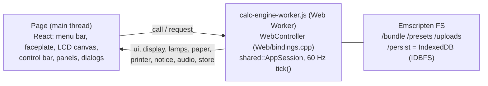

# Web client

The browser frontend: the same `Core/` + `Shared/` as the desktop app,
compiled to WebAssembly, with a React page that looks like the Qt window.
One build (`Web/dist/`) serves two uses:

- **embedded** in a web page, as a component;
- **installed** as an offline app (`dist/app/`, a PWA), for a tablet.

It is made for landscape screens and tablets; phones are not designed
for. The calculator comes first: the faceplate is as large as the client
allows, and the panels (inspector, plotter paper, printer) appear only when
the faceplate spans the full width and leaves at least 220 px below it --
in portrait and in tall windows, not on a phone in landscape or in a wide,
short window. Narrower than 700 px, the inspector gives way to the paper or
printer.



## Layout of `Web/`

| File | What it is |
|---|---|
| `bindings.cpp` | `WebController`: `AppSession` behind embind. Only translates; the decisions are Shared's |
| `calc-engine-worker.js` | The worker: fetches the files, mounts storage, ticks, passes messages |
| `audio-worklet.js` | The buzzer: PCM from the worker into a ring buffer |
| `src/*.jsx`, `src/*.js` | The client, compiled into one `dist/calc.js` (one global, `CalcU1600`) |
| `calc.css` | Styles, all under `.calcu-client`, light and dark |
| `app/` | The installable app: page, manifest, service worker, worker shim |
| `build.sh`, `build.js` | The build (below) |
| `tests/`, `run-tests.sh` | Playwright tests |
| `vendor/` | React 18, ReactDOM, ReactDOMServer (tests), Babel (build only) |

## Build and test

```sh
Web/build.sh        # emcmake build of the calcu_web target, then dist/
Web/run-tests.sh    # Playwright: root, sub-path, offline (Chromium, WebKit), prerender
```

`build.sh` needs `emcmake` (emsdk 6.0.13, as for the
[WebAssembly check](Building.md#webassembly-check)), node and the ROMs. The
engine is the CMake target `calcu_web` in `build-wasm/`
(`calcu1600-core.js` / `.wasm`): no `-pthread`, native wasm exceptions,
`IDBFS`. `build.js` compiles the JSX with the vendored Babel (no npm
runtime dependencies), copies the presets that
[`examples/bundled.yaml`](../../examples/bundled.yaml) lists (each with its
`examples/` folder, and the list itself) into `presets/`, writes `files.json`, stamps
the service worker's precache list and writes `MANIFEST.json`. CI's `web`
job builds, tests and uploads `Calc-U-1600-web-<version>.zip`; a release
attaches it as `Calc-U-1600-web.zip`.

## The `dist/` contract

- **Location independent.** Every URL is relative to `calc.js`
  (`document.currentScript`), so `dist/` works under any path. The tests
  serve it at a root and under `/anything/calc/`.
- **Embedding.** A page loads React 18, then `calc.css` and `calc.js`
  (classic scripts), and renders
  `React.createElement(CalcU1600, props)`:

  | Prop | Meaning |
  |---|---|
  | `width`, `height` | The client's size in CSS pixels (default: its parent's size) |
  | `keyboard` | Take the physical keyboard while focused (default true) |
  | `model` | 0 PC-1500, 1 PC-1500A, 2 PC-1600: start with it (read once, at mount) |
  | `preset` | A bundled preset to load at start (`plotter/lissajou-1600.pc1600`) |
  | `workerUrl` | Another worker entry (the app uses `app/engine-worker.js`) |

- **Prerender-safe.** Rendering has no side effects: the worker, fetches
  and listeners start in effects (`tests/prerender.spec.js`).
- **Scoped.** Styles are scoped to `.calcu-client`; `calc.js` adds only
  the `CalcU1600` global.
- **Test hooks.** `.calcu-client[data-ready=true]` once the engine runs;
  its `calcuEngine.request(method, ...args)` calls a `WebController`
  method (`lcdText` reads the screen); `.calcu-face[data-model]`,
  `.calcu-key[aria-label=<key>]`, `[data-panel=inspector|paper|printer]`
  (`data-empty`), `[data-dialog=...]`.
- **Same origin.** The worker and the service worker must come from the
  page's origin.

## Storage

- Settings: `localStorage`, keys prefixed `calcu1600/` (the names of
  `Shared/Settings.hpp`).
- The save folder (`AppPaths` home `/persist`): saved cards, disks, tapes.
  It is an IDBFS mount with `autoPersist`, so every write, rename and
  delete reaches IndexedDB without help. The embedded client and the app
  on one origin share it.
- **One writing tab.** The worker takes the Web Lock `calcu1600-storage`.
  A tab that doesn't get it reads the storage once, keeps its changes in
  memory and shows a banner.
- File ▸ Import / Saved Media… reach the save folder through
  `shared::MediaLibrary`.

## What the web client leaves out

Things that are only in the Qt app, or that a browser can't do:

- the DAP debugger (not in Shared);
- serial ports (PC-1600 RS-232C, CE-158 serial: host PTYs);
- the host drive S3: (Mount Directory);
- the INSPECTOR's TRACE and LOG;
- Quit, window size, folder settings.

## Input

- **Pointer.** One key per pointer, so a tablet can hold SHIFT and a
  key with two fingers. Holding the LCD runs turbo.
- **Keyboard.** `KeyboardEvent.code` / `.key` go to
  `shared::resolveHostKey`. A bare Shift tapped within 400 ms is SHIFT.
  Auto-repeat is ignored and held keys are released on blur. A release
  reaches the engine at least 50 ms after its press, since both can land
  in one frame.
- **Clipboard.** ⌘/Ctrl+C copies the screen; ⌘/Ctrl+V pastes text (the
  browser's paste event).
- **Drag and drop.** One file of up to 1 MB, routed by
  `dropfile::classify`.
- **Audio.** The AudioContext starts on the first key or click (a browser
  rule); the worker's `AudioSink` posts the PCM to the page.
